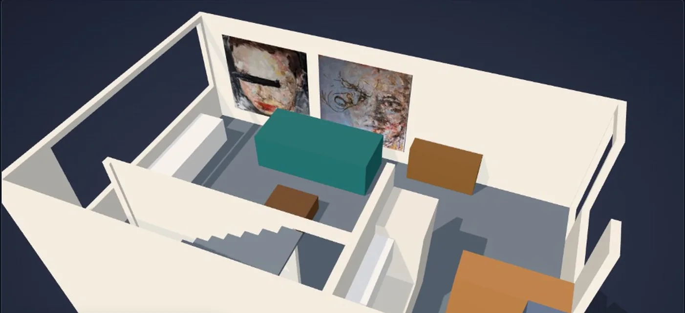
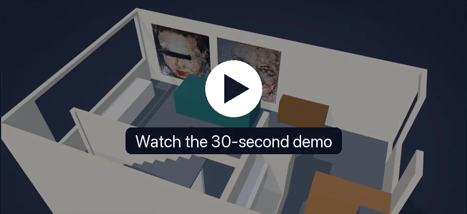
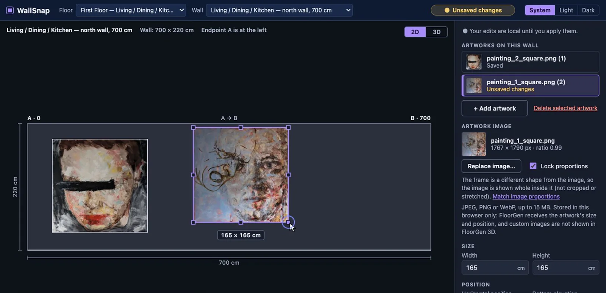
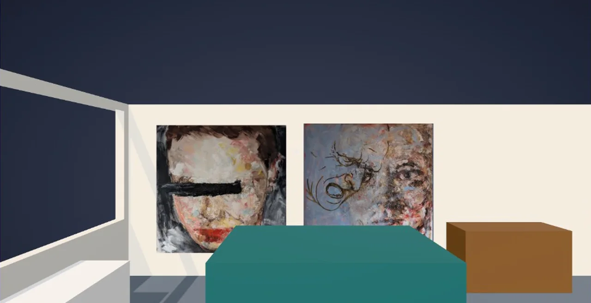

# WallSnap

**Hang real artwork on real walls:** WallSnap reads a FloorGen floor plan over MCP, lets you place paintings to the centimetre on a scale-accurate wall elevation, writes the placement back to FloorGen, and previews the result in the furnished 3D room.



<p align="center">
  <a href="https://markradomski.github.io/app/wallsnap/"></a>
  <br>
  <a href="https://markradomski.github.io/app/wallsnap/"><strong>▶ Watch the 30-second demo</strong></a>
</p>

## Place artwork in 2D, to scale



Pick a floor and wall and WallSnap draws it from FloorGen's own wall endpoints, height and openings. Drag a painting, resize it with its handles, nudge it with the arrow keys, or type exact centimetres. Bounds, doors and windows are checked before anything can be saved, and nothing leaves the browser until you press **Apply all changes**.

## Walk the room in 3D



The 3D view loads FloorGen's own GLB export of the house and hangs every saved artwork in it, textured with the image stored in this browser. Orbit around the floor, or switch to **Walk** for an eye-level view that collides with FloorGen's walls and furniture.

## Features

- **Scale-accurate SVG wall elevation** in centimetres, with doors and windows drawn where FloorGen has them, on any wall direction including slanted ones.
- **Several artworks per wall:** add, select, drag, resize (eight handles, optional locked proportions), keyboard nudges (1 cm, Shift for 10 cm) and labelled numeric inputs.
- **Validation before saving:** wall limits, the 200 cm height limit, and door/window overlaps, shown as hatching and as text.
- **Apply all changes:** saves every pending artwork on the wall one at a time, each revision-checked and read back from FloorGen before it counts as saved.
- **Reload from FloorGen:** re-reads an artwork that was moved in FloorGen, and says so if it is no longer on the wall.
- **Local artwork images** with proportional resizing, kept in the browser.
- **Three.js preview** of the imported FloorGen GLB, with **Orbit** and **Walk** modes.

More detail on each: [docs/technical-notes.md](docs/technical-notes.md).

## FloorGen integration and architecture

```
Browser (React + TypeScript + Vite)          Node adapter (Express)              FloorGen
  SVG editor, inspector, Three.js view  ──►   /api/* routes  ──►  write guard  ──►  MCP server
  images + GLB in IndexedDB (local only)      boundary validation of results       (DEV project)
```

The browser never talks to FloorGen directly and never sees the API key. The Node adapter reads walls, openings, rooms, furniture and items through FloorGen's MCP tools, validates every result at the boundary, and writes artwork placements with `place_on_wall` (flush contact and facing) and `update_items` (size).

| Saved in FloorGen (MCP) | Stored only in this browser |
| --- | --- |
| Each artwork's size, wall, position along it, height and facing, as a FloorGen picture item tagged `wallsnap` | The artwork's image (JPEG, PNG or WebP) |
| Read back and verified after every save | The imported GLB snapshot of the house |
| Shown in FloorGen's own 3D viewer as a plain picture object | Shown only in WallSnap's 2D editor and 3D preview |

FloorGen has no documented image or texture field for items, so custom images never reach FloorGen and are not shown in its viewer.

### Safety rules

- **Only `p_1ii0qmfr58hv4` (Townhouse — WallSnap DEV) is writable.** `server/safety.ts` wraps the MCP transport and checks the project ID on **every** write call before it is sent, refusing any other ID, including the original `p_128q3xq17slpfi`.
- Only these tools can be sent. Reads: `list_floors`, `list_entities`, `describe_project`, `get_entity`, `search_catalog`. Writes: `place_item`, `place_on_wall`, `update_items`, `soft_delete`. Anything else (for example `duplicate_project` or a permanent delete) is refused.
- The adapter sends `soft_delete` only for a single item tagged `wallsnap`, and only at the revision the user loaded.
- The server refuses to start if `FLOORGEN_PROJECT_ID` is anything other than the development copy.
- Every write carries `expected_rev`; Apply and Delete re-read the project first and return 409 on a revision mismatch rather than overwriting.
- Data returned by MCP is validated at the boundary (`server/boundary.ts`) before use.

### Code layout

| Path | Contents |
| --- | --- |
| `src/geometry.ts` | Pure geometry: wall frames, `u`/`v` conversions, bounds, opening collisions, resize (tested) |
| `src/App.tsx` | Screen state: walls, artwork slots, batch Apply, delete, reload |
| `src/Elevation.tsx` | SVG editor (drag, handles, keyboard) |
| `src/Inspector.tsx`, `src/TopBar.tsx` | Controls, artwork list, status |
| `src/saveState.ts`, `src/image.ts`, `src/imageStore.ts` | Save-state derivation, image validation, IndexedDB storage |
| `src/viewer3d/` | Lazy Three.js preview: GLB checks and storage, placement transforms, stand-in matching, Walk mode |
| `server/index.ts` | Express API and startup project check |
| `server/adapter.ts` | Reading walls and artworks, placement, Apply, delete, read-back |
| `server/safety.ts` | Write guard and tool allowlist |
| `server/boundary.ts` | Validation of MCP results |
| `server/gateway.ts` | MCP client |
| `server/mock.ts`, `server/fixture.ts` | Mock gateway with synthetic geometry |
| `e2e/` | Playwright tests (mock adapter only) |
| `spike3d/` | Earlier standalone 3D feasibility spike; not part of the app or the build (see its README) |

## Setup

```bash
npm install
cp .env.example .env     # then fill in FLOORGEN_API_KEY
npm run dev              # API on :8787 (WALLSNAP_API_PORT), web on http://localhost:5173
```

### Environment variables (`.env`, git-ignored)

| Variable | Purpose |
| --- | --- |
| `FLOORGEN_API_KEY` | FloorGen API key (`fg_live_…`, *Read & edit*). Server-side only; never sent to the browser. |
| `FLOORGEN_PROJECT_ID` | Must be the development copy `p_1ii0qmfr58hv4`. The server refuses to start with anything else. |
| `FLOORGEN_MCP_URL` | Defaults to `https://floorgen.app/mcp?toolsets=core,more,stairs`. |
| `WALLSNAP_ADAPTER` | `floorgen` (default) or `mock`. |
| `WALLSNAP_API_PORT` | API port, default `8787`. |

Create the key in FloorGen under **Agents & MCP** with *Read & edit* access to the development copy.

No key yet? `WALLSNAP_ADAPTER=mock npm run dev` runs against in-memory synthetic geometry and the UI shows a yellow **MOCK ADAPTER** banner. Mock mode is not a FloorGen integration.

### Commands

```bash
npm run dev         # API + web together (concurrently)
npm run typecheck   # tsc --noEmit
npm test            # Vitest unit tests
npm run e2e         # Playwright browser tests (starts its own mock API + Vite; one worker)
npm run build       # typecheck + production build
```

### Testing and verification status

Automated tests and live FloorGen verification are separate, and only the second touches FloorGen.

**Automated (no FloorGen access):**

- **Vitest** (`npm test`): geometry and coordinate conversions, opening collisions, resize, image validation and storage, save states, the MCP boundary validation, the write guard, the adapter and HTTP routes against a mock gateway, 3D placement transforms, model checks, stand-in matching and walk collision. Latest run (2026-10-30): typecheck clean, **369 tests passed** in 15 files.
- **Playwright** (`npm run e2e`): drag, numeric edits, keyboard nudging, validation, openings, resize handles, images, reload, multiple artworks, batch Apply, delete, the 3D preview and Walk mode. It runs only against the mock adapter and a synthetic GLB; it does not verify FloorGen. Not re-run in the latest documentation pass.

**Live FloorGen (development copy only):**

- Verified on 2026-10-25: authenticated MCP connection, reading real walls, and `place_on_wall` + `update_items` to create an artwork (south wall, rotation 180) and update one (north wall), with read-back. Cross-checked through a separate FloorGen connection and the 2D render.
- The 3D preview was checked in a browser with the real townhouse GLB export.
- 2026-10-30, read-only: FloorGen's own 3D viewer shows the saved first-floor artworks on their walls, as plain picture objects (seen while recording the demo).
- **Not yet verified live:** multiple artworks per wall, batch Apply, delete (`soft_delete`), walls with openings, diagonal real walls, and the stale-revision path against the real server.

## Current limitations

- Images and the imported GLB live in one browser profile: not shared between browsers or devices, lost if site data is cleared. A draft image for a wall that is never saved stays in that browser's storage.
- Apply all changes covers the current wall only. Unsaved artworks on other walls are kept for the session but must be applied from their own wall.
- An artwork moved off its wall *before* the wall was opened in WallSnap cannot be traced back to that wall, so it does not appear there. Reload checks the selected artwork by id.
- An artwork that still hangs on the wall but has an out-of-range size or elevation is shown with its real numbers and the usual validation errors.
- The reserved-wall rule is a length heuristic. Lighting is not checked. Walls bounding no room are not offered; for a wall shared by two rooms the first room's face is used.
- Whether FloorGen's item width/height is the visible picture face or includes a frame is unconfirmed.
- 3D: the model is only as current as its export. Matching the stand-in relies on FloorGen's generic artwork colour. There is no 3D dragging.
- Walk: FloorGen does not report whether a door is open, so every interior doorway is treated as open. Stair footprints are conservative rectangles, so on the DEV first floor the only interior door (to the stairwell) cannot be passed. Fixed eye height, no stairs, gravity or jumping. Headless Chromium and the in-app browser refuse mouse capture, so real capture has not been verified.

## Demo video

The 30-second demo shows, in order: FloorGen's own 3D view of the first floor, the same room in WallSnap with the real paintings, editing the north wall in 2D (including a wall-boundary error), and a Walk through the living room. It was recorded read-only against the DEV project: nothing was applied or written to FloorGen.

**Watch it in the case study:** [markradomski.github.io/app/wallsnap](https://markradomski.github.io/app/wallsnap/)
