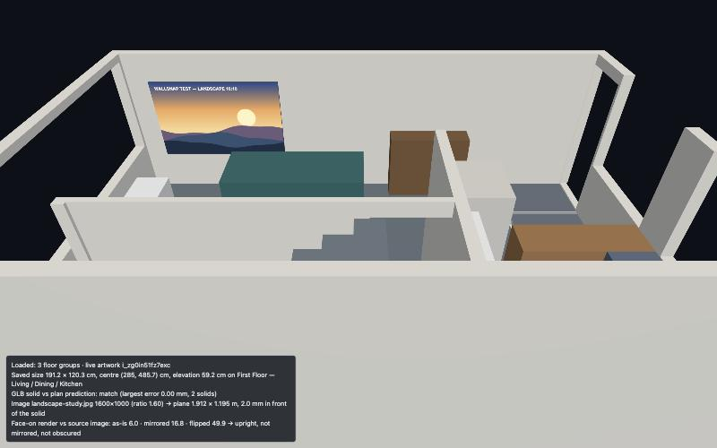
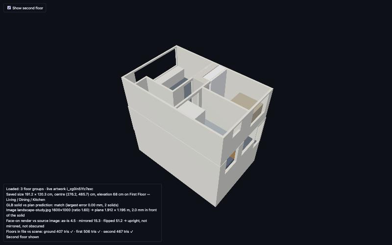

# Phase 5A: 3D feasibility spike

**Result: it works.** One real uploaded artwork image is shown as a texture, at the size and position FloorGen saved, on the
north wall of the furnished first-floor room in FloorGen's exported GLB. This is a standalone, development-only experiment:
the production 2D editor does not import any of it, and `vite build` ignores it.



## Run it

```bash
# 1. read-only companion (serves the GLB and the live artwork's plan data; never writes to FloorGen)
SPIKE_GLB_PATH=~/Downloads/townhouse-wallsnap-dev-3d.glb npx tsx --env-file=.env spike3d/server.ts   # :8788
# 2. the normal WallSnap dev server (the page must share its origin to read the stored image from IndexedDB)
npm run dev
# 3. open http://localhost:5173/spike3d/index.html   (drag to orbit, scroll to zoom)
```

The GLB is a private project export, so it is **not committed**: the server streams it from `SPIKE_GLB_PATH` (default
`~/Downloads/townhouse-wallsnap-dev-3d.glb`). The artwork image must already be stored in the same browser (upload it in
WallSnap first). Everything about the artwork (item id, position, size, floor) is read live; nothing is hard-coded.

## The verified transformation

FloorGen plan: centimetres, x right, **y down the plan**, rotation degrees clockwise. glTF: metres, Y up.

| Quantity | Rule |
| --- | --- |
| Plan x | `X = x / 100` |
| Plan y | `Z = y / 100` (**no flip**; the map keeps the plan's handedness) |
| Elevation | `Y = (floor base + elevation) / 100` |
| First-floor base | `220 cm`: the sum of the heights of the floors below (ground floor = 0, first = 220, second = 440) |
| Item front direction | plan `(-sin θ, cos θ)`, i.e. world `(X, Z) = (-sin θ, cos θ)` |
| Textured plane | `PlaneGeometry` faces +Z; set `rotation.y = -θ`. Its normal is then the item front, and its local +X (image left to right) is the viewer's right |
| Plane position | item centre moved `depth/2 + 0.2 cm` along the front direction (the generic solid's front face plus 2 mm) |
| Wall direction | `u` is measured from endpoint A exactly as in the 2D editor: plan x of the item is `A + u · dir + perp · n`; no extra GLB step |

The GLB uses **no node transforms**: floor groups are siblings at their own heights, with all vertices in world metres.

### Verified against the GLB's own geometry (not by eye)

The GLB (`townhouse-wallsnap-dev-3d.glb`, generator FloorGen, 14 nodes, 21 materials, no textures) has **one merged mesh per
floor and category** (walls, floors, furniture, stairs). Node names are floor names only: there are **no item ids** in it, so
items cannot be found by name. FloorGen gives each generic artwork the colour `#4b5a70`, which becomes its own material, so
its vertices can be isolated and split into solids (`solids.ts`) and compared with an item's predicted box.

| Check | Plan data | GLB |
| --- | --- | --- |
| First-floor extents, x | wall outer faces 142.5 and 857.5 cm | 1.4243 and 8.5757 m |
| First-floor extents, z | wall outer faces 469.8 and 937.97 cm | 4.6981 and 9.3797 m |
| Floor base | ground floor height 220 cm | first-floor mesh at y = 2.2 m, second at 4.4 m |
| Room faces | north wall face 484.15 cm, south face 922.03 cm, east face 842.5 cm | floor mesh z 4.8415 to 9.2203 m, x to 8.425 m |
| North artwork (θ = 0): x 285, y 485.7, 191.2 × 120.3 × 3, elevation 59.2 | X 189.4 to 380.6, Y 279.2 to 399.5, Z 484.2 to 487.2 cm | **identical** |
| South artwork (θ = 180): x 519.1, y 920.5, 36 × 48.6 × 3, elevation 124.2 | X 501.1 to 537.1, Y 344.2 to 392.8, Z 919 to 922 cm | **identical** |

The viewer repeats the north-artwork check on every load; it reports a largest error of **0.0002 mm**.

### What the page checks for the textured plane

* Texture: the stored image (an `HTMLImageElement` from the local blob, sRGB), not a placeholder.
* Size: the frame is the saved item's 191.2 × 120.3 cm; the image is fitted inside it by its own aspect ratio (1600 × 1000, 1.60),
  giving a 1.912 × 1.195 m plane, never cropped or stretched.
* Position: 2.0 mm in front of the generic solid's front face, centred on the item.
* Facing: world normal `(0, 0, 1)` = the wall's room-facing normal; the plane is front-face only, so it is only visible from the room.
* Orientation: the plane is rendered face-on offscreen and compared with the source image under four hypotheses
  (as is, mirrored, flipped, both). Mean channel error: **as is 6.0**, mirrored 16.8, flipped 49.9, both 51.4. The correct reading is
  the best, so the picture is upright, not mirrored, and not hidden by the generic solid.

Unit tests (`transform.test.ts`) cover the math for every rotation and wall direction, including slanted walls and the
app's own `facingRotation`.

## Why only two floors showed, and the control for the third

**Root cause: the viewer hid the second floor on purpose.** The first version of the viewer set `visible = false` on the
second-floor group so the camera could look down into the first-floor room (the second floor is a solid slab directly above it).
That was not documented on screen, so the townhouse looked incomplete. It was not a problem with the model or the loader.

Everything else was checked and ruled out, in the file and in the live scene:

| Question | Finding |
| --- | --- |
| Does the GLB contain all three floors with renderable geometry? | Yes. Ground 407 triangles (8 meshes), first 506 (13), second 467 (10). No degenerate triangles, no non-finite vertices. The second floor has no stairs mesh because the FloorGen project has none there. |
| Are they in the right place? | Bounds stack cleanly at Y 0 to 2.2, 2.2 to 4.4 and 4.4 to 6.6 m over the same X/Z footprint. |
| Did the viewer load every mesh? | Yes: per floor, loaded meshes, triangles and bounds equal what the file declares (`/model-info` reads the GLB's JSON chunk; bounds agree to 0.1 mm). 32 mesh objects = 31 floor meshes + the artwork plane. |
| Anything dropped, shifted, rescaled or duplicated? | No: every floor group has scale 1 and position 0, and nothing is added or copied. |
| Clipping or culling? | No renderer or material clipping planes; no mesh has frustum culling disabled. |
| Camera? | Near 0.05 m, far 100 m; the building is about 10 m across, and the second floor is inside the camera frustum. |
| What stopped it drawing? | Only `visible: false` on the second-floor group. |

**The control:** one checkbox, **Show second floor** (top-left), or `?floors=all` in the URL. It only toggles `visible`, so the artwork
plane, its texture, position, orientation and room-facing behaviour are untouched (checked: identical before and after). It is off by
default so the first-floor room and the artwork are visible straight away; the HUD says so and reports, per floor, whether the file
and the scene agree. With the box ticked the camera is still framed on the first floor, so orbit or zoom out to see the whole building.



Note: the model was re-exported on 26 Oct, after the artwork was moved in FloorGen (its elevation is now 68 cm). The 0.00 mm
match against the generic solid still holds against the new file, and the geometry of the three floors is otherwise unchanged. The
numbers in the verification table above are from the first export.

## Limitations that would affect integration

1. **The model is a manual, stale snapshot.** `get_context` lists `export_glb` as "coming soon", so there is no MCP call to export
   it. The GLB must be exported by hand and matches FloorGen only as of its export time (here: after the last edit, so it matched).
2. **No item ids in the GLB.** Items are matched by geometry (colour `#4b5a70` plus the predicted box). That works and is exact,
   but two items with identical geometry would be ambiguous, and any other furniture in that colour would be included.
3. **The generic solid cannot be hidden by name.** It is part of the merged furniture mesh. The plane is overlaid 2 mm in front; to
   remove the solid you would delete the matched vertices from that mesh. A thin strip of the solid shows when the frame and image
   ratios differ.
4. **Only θ = 0 and θ = 180 are verified against real GLB solids**; those are the artworks that exist. Walls facing east and west
   (θ = 90, 270) are covered by the unit-tested math and by the wall-face extents above, but not by an artwork solid.
5. **FloorGen's `mirror` flag** is set on this item. The solid is symmetric so the GLB cannot show what mirroring means for a
   picture; the spike does not mirror the image.
6. **The image is unlit** (`MeshBasicMaterial`) so its colours are true; in the lit room it will look brighter than FloorGen's own
   shading. A lit material is a one-line change but a design decision.
7. **The image lives in IndexedDB**, so the viewer must run on WallSnap's origin and in the same browser profile.
8. Still FloorGen's 3D viewer itself will not show the image: this is a separate WallSnap viewer.
